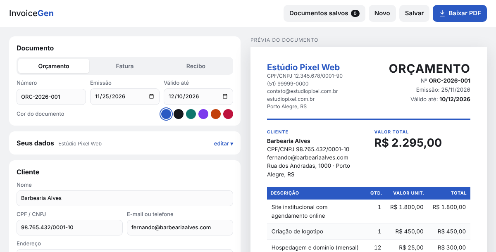

# InvoiceGen — Orçamentos e faturas

Gerador de orçamentos e faturas com cliente, itens, valores e desconto, com exportação em PDF.

🔗 **[Ver o site no ar](https://iamviniciuslima05.github.io/PROJETO-InvoiceGen/)**



## Funcionalidades

- **Orçamento, fatura ou recibo**
- Dados do **emitente** salvos para os próximos documentos
- Dados do **cliente** e **itens** com quantidade e valor
- **Desconto** em % ou em reais e frete/taxa
- **Prévia em tamanho A4** atualizada enquanto você digita
- **Baixar PDF** pelo “Salvar como PDF” do navegador
- Numeração automática
- **Documentos salvos**: abrir, duplicar e transformar orçamento em fatura
- Cor do documento personalizável

## Tecnologias

HTML5 · CSS3 · JavaScript · CSS de impressão · localStorage

## Estrutura

```
index.html
css/style.css
js/script.js
```

## Como rodar

Não precisa instalar nada: baixe o projeto e abra o `index.html` no navegador, ou acesse a versão publicada acima.

---
Feito por **Vinicius Lima** · [Portfólio](https://viniciuslimadev.netlify.app) · [LinkedIn](https://www.linkedin.com/in/viniciuslima25/)
